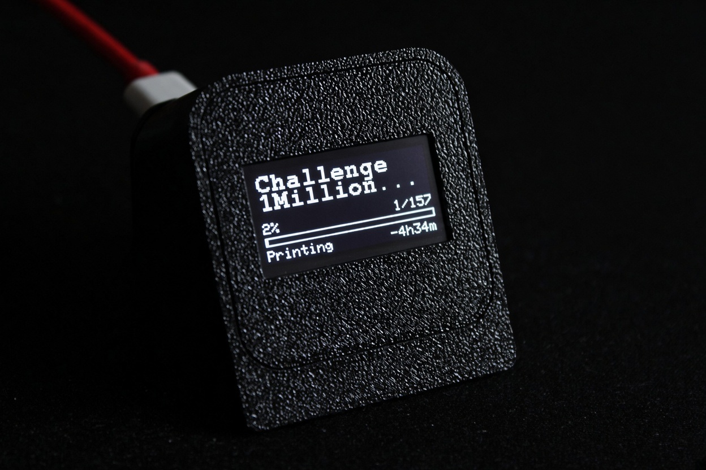

# BambuHelper-Mono



A fork of [BambuHelper](https://github.com/Keralots/BambuHelper) that turns an **ESP32-C3 SuperMini + SH1106 128×64 monochrome OLED** into a tiny, always-on Bambu Lab print monitor.

- Real-time printer status over LAN MQTT or Bambu Cloud
- Purpose-built mono UI: idle clock, printing, pause, done, error, offline
- Optional OpenWeatherMap icon + temperature on the idle clock
- Everything configured from the built-in web portal
- 3D-printed case: [MakerWorld model](https://makerworld.com/en/models/3424957-terminal-case-for-ssd1106-1-3-oled-and-esp32#profileId-3903569)

## Why this fork?

Upstream BambuHelper is built around colour TFT panels. Its display layer (LovyanGFX / TFT_eSPI, gauge layouts, cards, animations) assumes a much larger, colour screen, so adding a 128×64 monochrome OLED there would have meant reshaping the whole display architecture.

This fork keeps the mono work self-contained in a separate display path:

| File | Purpose |
|---|---|
| `src/mono_display.h` / `.cpp` | Screen selection, layout, drawing and change detection |
| `src/mono_weather.h` / `.cpp` | OpenWeatherMap fetch/cache for the idle clock |
| `include/mono_weather_icons.h` | 30×30 weather bitmaps |
| `platformio.ini` (`mono-c3`) | Dedicated PlatformIO environment (`BOARD_IS_MONO`) |

**Original repository:** [github.com/Keralots/BambuHelper](https://github.com/Keralots/BambuHelper)

This fork tracks upstream **v3.9.0**. Mono-specific changes only; for the full upstream feature set and cloud/security notes, see the original repository.

## Hardware

| Part | Detail |
|---|---|
| MCU | ESP32-C3 SuperMini (4 MB flash) |
| Display | SH1106 1.3" 128×64 monochrome OLED, I2C |
| Touch | none |
| Backlight | none (the SH1106 has no backlight pin) |

### Wiring

| OLED pin | ESP32-C3 SuperMini |
|---|---|
| VCC | 3V3 |
| GND | GND |
| SDA | GPIO8 |
| SCL | GPIO9 |

- I2C address `0x3C` by default. Modules strapped to `0x3D` work by adding `-D OLED_I2C_ADDR=0x3D` to the `mono-c3` env.
- No reset pin is used (`OLED_RESET=-1`); the I2C bus runs at 400 kHz.
- Only four wires are needed. Make sure VCC is **3.3 V**, never 5 V.

### Case

[**MakerWorld: Terminal case for SSD1106 1.3" OLED + ESP32**](https://makerworld.com/en/models/3424957-terminal-case-for-ssd1106-1-3-oled-and-esp32#profileId-3903569)

## Build and flash

### Prerequisites

- [PlatformIO](https://platformio.org/) — VS Code extension or the `pio` CLI
- A USB-C **data** cable (many ESP32-C3 SuperMini cables are charge-only)

### First flash (USB)

```bash
git clone https://github.com/alejandrosnz/BambuHelper.git
cd BambuHelper

pio run -e mono-c3                  # build
pio run -e mono-c3 -t upload        # flash over USB
pio run -e mono-c3 -t monitor       # serial console, 115200 baud
```

If the upload cannot connect, hold **BOOT** while plugging the board in, then retry.

### Updates

- **OTA from the web UI:** WiFi & System → Firmware update (GitHub Releases or a manual `.bin`)
- **USB:** repeat `pio run -e mono-c3 -t upload`

Settings are stored in NVS and survive OTA updates.

## First-time setup

1. Power the board. The boot screen shows the device IP and the configured printers with live `[on]` / `[off]` flags.
2. Join your WiFi:
   - **AP portal (default):** connect to `BambuHelper-XXXX` (password `bambu1234`) and open <http://192.168.4.1>, or
   - **Improv-Serial:** send credentials over USB from any Improv-compatible client during the first-boot window.
3. Open the device IP shown on the OLED in a browser.
4. Add your printer:
   - **LAN Direct:** printer IP + LAN access code
   - **Bambu Cloud:** sign in with email code, password, or an access token
5. Under **Clock**, set the timezone (DST switches automatically) and, if you want it, 24-hour time.
6. Tune the display under **Print screen → Mono OLED** (see [Settings](#settings)).

> The web portal has no password and runs over plain HTTP. On networks you do not fully trust, prefer the email-code or token cloud login. See the upstream README for the full cloud security notes.

## Screens

| Screen | When | What it shows |
|---|---|---|
| Boot | Power-on / WiFi resolving | Device IP (or AP SSID) and configured printers with `[on]` / `[off]` |
| Offline | Printer not connected | Printer name, device IP, printer target (`to <ip>` / `to cloud`) |
| Heating | `PREPARE` | Title, nozzle/bed temps (current/target), progress bar |
| Printing | `RUNNING` | 2-line job title, `%` + layer, progress bar, current stage + remaining time / ETA |
| Pause | `PAUSE` | Same layout with a pause icon and blinking progress fill |
| Done | `FINISH` | 2-line title, boxed `DONE`, optional cooldown temps; returns to the idle screen after ~3 minutes |
| Error | `FAILED` / print error | `ERR`, code/state and job name |
| Idle / screensaver | Printer idle | Big clock (or big temps when NTP is down), optional weather icon + temperature, status icon (X / circle), optional `HOT` warning |

- Static screens refresh once per second; marquee and blink run at ~10 fps.
- The job title wraps to two 11-character lines and shows `...` on overflow.
- On the C3, HMS errors show **codes on the screen**; the full sentence is resolved in the web portal.

## Settings

### Mono OLED card (Print screen → Mono OLED)

| Setting | Default | What it does |
|---|---|---|
| Show Layer line while printing | On | `layer/total` next to the percentage |
| Show progress bar while printing | On | 6 px progress bar above the bottom row |
| Alternate remaining time and ETA bottom-right (5 s) | On | Switches between `-1h05m` and the wall-clock finish time |
| Show remaining time while printing | On | Off = the current stage uses the full width |
| Show temps on the Done screen | Off | Nozzle/bed cooldown row on the Done screen |
| Show big clock when idle (off = big temps) | On | Idle screen shows the clock, or large temps when off |
| Show connection icon on the clock (X / circle) | Off | Network / printer liveness indicator |
| Show HOT warning when idle | Off | Warns when the nozzle is above 50 °C while idle |
| Show boot screen with WiFi/IP (off = straight to clock) | On | AP mode and WiFi failures still show the boot screen |
| Show weather icon + temperature | Off | OpenWeatherMap on the idle clock |
| Weather API key | *(empty)* | Free OpenWeatherMap key |
| Location | `Madrid,ES` | `City,CC`, no spaces |
| OLED contrast | 255 | SH1106 hardware contrast, range 20–255, applies instantly |

### Other settings that affect the mono display

- **Clock:** timezone and 24-hour format (also drives the ETA / end time on the print screen).
- **Printer:** LAN or Bambu Cloud connection and the printer name.
- **WiFi & System:** WiFi, DHCP/static IP, mDNS hostname, JSON settings backup and OTA.
- **Diagnostics:** serial log, heap and connection status.

TFT-only sections (Display, After print, Colors, Hardware, Power) are hidden automatically on the mono board, so the portal only shows what applies.

### Weather

- Free OpenWeatherMap key: <https://openweathermap.org/appid>
- Enable **Show weather icon + temperature**, paste the key, set the location as `City,CC` (for example `Madrid,ES`), then save.
- The device polls only while the idle clock is visible, every 15 minutes. The fetch runs in a background task, so it never blocks MQTT or the web server.
- The API key is stored locally and deliberately **not** included in JSON settings backups.

## Limitations

- **1 printer only** — the C3 has no PSRAM and the mono layer targets a single printer.
- **No touch, buttons or backlight** — the four-wire OLED has none; the clock/screensaver handles idle display.
- **Monochrome 128×64 only** — the TFT gauge/card layouts do not apply.
- **HMS text is not embedded on the C3** — the OLED shows the code, the web portal resolves the full sentence.
- **ArduinoJson v7** is pinned for this fork; the upstream parser rewrite is not included.

## Credits

- Original project: [Keralots/BambuHelper](https://github.com/Keralots/BambuHelper) and its contributors.
- Mono UI style inspired by the ESP-Spotify-OLED reference.
- Display drivers: [Adafruit GFX](https://github.com/adafruit/Adafruit-GFX-Library) and [Adafruit SH110X](https://github.com/adafruit/Adafruit_SH110X).
- Case: [MakerWorld model](https://makerworld.com/en/models/3424957-terminal-case-for-ssd1106-1-3-oled-and-esp32#profileId-3903569).

This fork keeps the upstream project's terms and credits. See the original repository for licensing and the complete upstream documentation.
